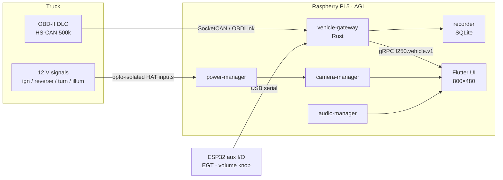

# TruckDashboard — F-250 AGL head unit

An open-source infotainment and vehicle-monitoring head unit for one truck: a
**2007 Ford F-250 Super Duty with the 6.0L Power Stroke**. It runs on a
**Raspberry Pi 5** under **Automotive Grade Linux (AGL)**, with the original 7"
800×480 Raspberry Pi touchscreen.

The goals, in priority order:

1. Reliable Power Stroke telemetry
2. Honest stale-data warnings
3. A responsive touchscreen
4. Safe electrical integration
5. A modular architecture

It also provides:

- Bluetooth audio
- offline navigation
- backup and side cameras
- logging
- ignition-aware power management

> **Safety.** This is not a safety system. The factory cluster, mirrors and normal
> reversing procedures remain the authority. Vehicle access is read-only.
> Nothing is transmitted on the vehicle bus until explicitly enabled. See
> [docs/safety/assumptions.md](docs/safety/assumptions.md).

## Status

Phases 0–3 are complete. The repository is migrated, a **simulated** 800×480
dashboard runs on the Mac, and the Rust vehicle gateway runs with the simulator
or (untested on hardware) the MX+. See [docs/setup/gateway.md](docs/setup/gateway.md).

| Area | State |
|---|---|
| ESP32 firmware (`firmware/esp32/`) | Builds; 140 host tests pass. On the truck, reads RPM and transmission temp through an OBDLink MX+ `[TRUCK]` |
| Architecture, ADRs, hardware research | Written. See [docs/architecture/](docs/architecture/overview.md) |
| Flutter dashboard (`apps/infotainment`) | Runs with **simulated** data: gauges, global alerts, stale-data handling, diagnostics, fuel level, speed calibration. 99 tests `[SIM]` |
| Power Stroke simulator (`simulator/powerstroke`) | 6 scenarios, including the EOT/ECT freeze. 27 tests `[SIM]` |
| Rust vehicle gateway (`services/vehicle-gateway`) | Runs with the simulator or the MX+ (serial/TCP/RFCOMM). gRPC API, recovery logic, recorder, `obd-console`. Tested against a fake adapter replaying the truck's captures `[SIM]`. **Not yet run against the real MX+** |
| MX+ truck trial | Phase 3.5. Not started. Needs only owned hardware |
| CAN hardware, AGL image, infotainment | Phases 4–7. Not started. **No head-unit hardware purchased yet.** Purchases are decided by the MX+ trial |

**Next: Phase 3.5, an MX+ truck trial**: the Pi 5 and display on Raspberry Pi OS,
talking to the OBDLink MX+ over Bluetooth. It needs no new hardware, and its
data decides what to buy ([ADR-0011](docs/architecture/adr/0011-mx-plus-trial-first.md)).

The full plan is [docs/PROJECT_PLAN.md](docs/PROJECT_PLAN.md), and the checklist
is [docs/ROADMAP.md](docs/ROADMAP.md).

## What is known about the truck

The facts below were verified on the truck. Their evidence is in
[docs/diagnostics/VERIFICATION_LOG.md](docs/diagnostics/VERIFICATION_LOG.md).

- The diagnostic link is ISO 15765-4: CAN, 11-bit IDs, 500 kbaud.
- Two modules answer functional requests. `7E8` is the PCM and `7E9` is the TCM.
- Transmission fluid temperature is `22 1674`, answered by the TCM.

Every other Ford enhanced PID is imported from a Torque Pro export and stays
**unverified** until it has its own log entry.

## Architecture in one picture



Details: [docs/architecture/overview.md](docs/architecture/overview.md).

## Quick start (macOS, Apple Silicon)

```bash
make setup      # installs or checks the dev tools with Homebrew (see docs/setup/macos.md)
make test       # runs every test that exists for this environment
make lint       # Markdown link check, plus linters as components appear
make ui-web     # dashboard in a browser at http://127.0.0.1:8250 (simulated data)
make ui-web SCENARIO=eot_ect_freeze START=110   # jump straight to the EOT/ECT freeze
make sim        # Rust gateway (simulated) + macOS app reading from it over gRPC
make console    # obd-console against a running gateway
```

ESP32 firmware only:

```bash
make fw-test    # 140 host-side tests, no hardware
make fw-build   # build for the ESP32-WROOM-32
```

On the Pi 5 with Raspberry Pi OS (the Phase 3.5 MX+ trial), use `make pi-setup`,
`make pi-build` and `make pi-run`. See [docs/setup/raspberry-pi.md](docs/setup/raspberry-pi.md).

AGL images build on a Linux x86_64 host, not on the Mac. See
[docs/setup/linux-build-host.md](docs/setup/linux-build-host.md).

## Repository layout

| Path | Contents |
|---|---|
| [`CLAUDE.md`](CLAUDE.md) | Rules for AI-assisted development (safety, verification, testing) |
| [`docs/`](docs/) | [architecture](docs/architecture/overview.md), [hardware](docs/hardware/compatibility-matrix.md), [safety](docs/safety/assumptions.md), [setup](docs/setup/macos.md), [diagnostics](docs/diagnostics/FORD_6_0_PIDS.md), [esp32](docs/esp32/ARCHITECTURE.md) |
| [`firmware/esp32/`](firmware/esp32/README.md) | ESP32 firmware (PlatformIO) |
| [`shared/signals/`](shared/signals/) | Signal registry and the Torque PID import |
| [`tools/dev/`](tools/dev/) | Development scripts: macOS setup, link checker |
| [`apps/infotainment/`](apps/infotainment/README.md) | Flutter touchscreen UI |
| [`simulator/powerstroke/`](simulator/powerstroke/README.md) | Scenario simulator and scenario files |
| `crates/` | Rust libraries: `elm` (MX+ client), `telemetry` (registry, validity, warnings), `powerstroke-sim`, `proto` |
| `services/` | `vehicle-gateway`, `recorder` |
| `tools/obd-console/` | Diagnostics console for the gateway |
| [`shared/proto/`](shared/proto/f250/vehicle/v1/vehicle.proto) | Versioned gRPC API |
| `agl/`, `tests/` | Not created yet ([roadmap](docs/ROADMAP.md)) |

## License

Not yet chosen. This is an open decision for the owner.
