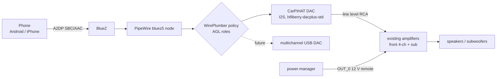

# Audio routing

Status: **design**. It is implemented in `services/audio-manager` in Phase 6.

What has been checked: the AGL Vimba Pi 5 image contains these packages:

- PipeWire 1.6.6
- WirePlumber 0.5.14 with the AGL configuration
- BlueZ 5.86
- the bluez5 SPA plugin
- ofono

A working **A2DP sink** (the phone streaming to the car) is **not documented**
by AGL, and is to be proven in Phase 6.

## Signal chain

- **The Pi never drives speakers directly.** Line out only, to amplifiers.
- The amplifier inventory is still unknown. Inspect it before buying anything
  (Phase 6/7). Options:
  - reuse the existing amplifiers
  - a compact 4-channel amplifier
  - a separate subwoofer amplifier
  - a future multichannel USB DAC

## audio-manager responsibilities

| Responsibility | How |
|---|---|
| Pairing | Only inside an explicit **pairing window** opened from the UI (default 120 s). Not discoverable otherwise. Advertised as an audio sink with a clear name ("F-250") |
| Active device | Several phones may be paired. The policy is: last connected wins, unless a phone is pinned as preferred. Switching is explicit in the UI |
| Reconnect | Reconnect automatically to known devices on boot and after a link drop, with bounded backoff |
| Controls and metadata | AVRCP through BlueZ `MediaPlayer1`: play/pause/next/previous, title, artist, album. Album art only where the phone supports it (AVRCP 1.6 cover art); unsupported otherwise |
| Volume | One master volume with a configurable **maximum**, plus the physical knob. Absolute volume (AVRCP) where supported |
| Sources | Bluetooth (phase 6). Navigation prompts are ducked over media later. A USB or local-files source is possible later |
| Future HFP | ofono is present. Keep a route for microphone and echo cancellation, but do not block release 1 on calling |

## Pop prevention and failure safety

- On startup, the DAC is muted, then the pipeline comes up, then a settle delay,
  then the amp remote turns on, then the DAC unmutes.
- On shutdown, the DAC is muted, then the amp remote turns off, then a delay,
  then the pipeline stops.
- A Pi crash must leave the amplifiers **off**. That depends on the OUT_0
  default state, which is to be verified (see
  [power-states.md](power-states.md#crash-and-reset-behaviour-to-be-verified-on-hardware)).
- The CarPiHAT DAC line-out level and mute behaviour are undocumented. Measure
  them before connecting the amplifiers, and set the amplifier gain against a
  0 dBFS test tone.
