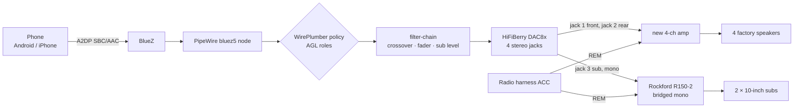

# Audio routing

Status: **design**. It is implemented in `services/audio-manager` in Phase 6.

What has been checked: the AGL Vimba Pi 5 image contains these packages:

- PipeWire 1.6.6
- WirePlumber 0.5.14 with the AGL configuration
- BlueZ 5.86
- the bluez5 SPA plugin
- ofono

A working **A2DP sink** (the phone streaming to the car) is **not documented**
by AGL, and is to be proven in Phase 6.

## Signal chain

- **The Pi never drives speakers directly.** Line out only, to amplifiers.
- The DAC, the channel map and keeping the R150-2 are decided in
  [ADR-0014](adr/0014-multichannel-dac8x.md). The wiring is in
  [wiring/audio.md](../wiring/audio.md).
- What the Pioneer did and what replaces it (owner, 2026-11-04): its built-in
  amp drove the 4 SuperCab speakers, so a new 4-channel amp replaces that.
  Its sub pre-out fed the R150-2, so DAC8x jack 3 now feeds it.

## Channel map and DSP

| DAC8x jack | Destination | Processing (example values, configuration) |
|---|---|---|
| 1 | 4-ch amp front | High-pass (for example 80 Hz), balance |
| 2 | 4-ch amp rear | High-pass, balance, fader against jack 1 |
| 3 | R150-2, both legs | (L+R)/2, low-pass (for example 80 Hz), sub level |
| 4 | — | Spare |

- The crossover runs in a PipeWire **filter-chain** in front of the DAC8x
  sink. audio-manager writes and owns its parameters.
- The fader, balance, sub level and crossover frequency are user settings with
  configured limits. The defaults are examples, not recommendations (rule 10).
- audio-manager validates the configuration before applying it. For example,
  no full-range signal to jack 3, and the front and rear filters never off
  without an explicit setting. Both are unit-tested `[SIM]`.
- Which ALSA channel pair comes out of which physical jack is TODO, found on
  the bench ([wiring checks](../wiring/audio.md#checks-before-sign-off)).

## audio-manager responsibilities

| Responsibility | How |
|---|---|
| Pairing | Only inside an explicit **pairing window** opened from the UI (default 120 s). Not discoverable otherwise. Advertised as an audio sink with a clear name ("F-250") |
| Active device | Several phones may be paired. The policy is: last connected wins, unless a phone is pinned as preferred. Switching is explicit in the UI |
| Reconnect | Reconnect automatically to known devices on boot and after a link drop, with bounded backoff |
| Controls and metadata | AVRCP through BlueZ `MediaPlayer1`: play/pause/next/previous, title, artist, album. Album art only where the phone supports it (AVRCP 1.6 cover art); unsupported otherwise |
| Volume | One master volume with a configurable **maximum**, plus the physical knob. Absolute volume (AVRCP) where supported |
| Sources | Bluetooth (phase 6). Navigation prompts are ducked over media later. A USB or local-files source is possible later |
| Future HFP | ofono is present. Keep a route for microphone and echo cancellation, but do not block release 1 on calling |

## Pop prevention and failure safety

- **The Pi doesn't switch the amplifiers.** Their remote leads are on ACC,
  with no timer ([ADR-0014](adr/0014-multichannel-dac8x.md),
  [wiring](../wiring/audio.md#remote-turn-on-acc-straight-to-rem)).
- On startup the amps are already on while the Pi boots. The DAC stays muted
  until the pipeline is up; whether the DAC8x itself pops as it initialises
  is measured on the bench (H6). If it does, a delay-on timer relay goes
  between ACC and REM.
- At key-off, ACC drops and the amps go off at once. The Pi mutes the DAC and
  stops the pipeline later, during its own shutdown.
- A Pi crash with the key on leaves the amplifiers **on**. What the speakers
  then do (silence, a pop or a buzz) is to be measured (H5, see
  [power-states.md](power-states.md#crash-and-reset-behaviour-to-be-verified-on-hardware)).
  Key-off always ends it.
- The DAC is no longer the CarPiHAT's
  ([ADR-0013](adr/0013-dcdc-usb-power-supply.md)). It is the HiFiBerry DAC8x
  ([ADR-0014](adr/0014-multichannel-dac8x.md)). Its maximum output (2.1 Vrms)
  is documented; its **mute-at-boot behaviour is not** (H6). Measure both
  before connecting the amplifiers, and set the amplifier gain against a
  0 dBFS test tone ([gain staging](../wiring/audio.md#gain-staging)).
