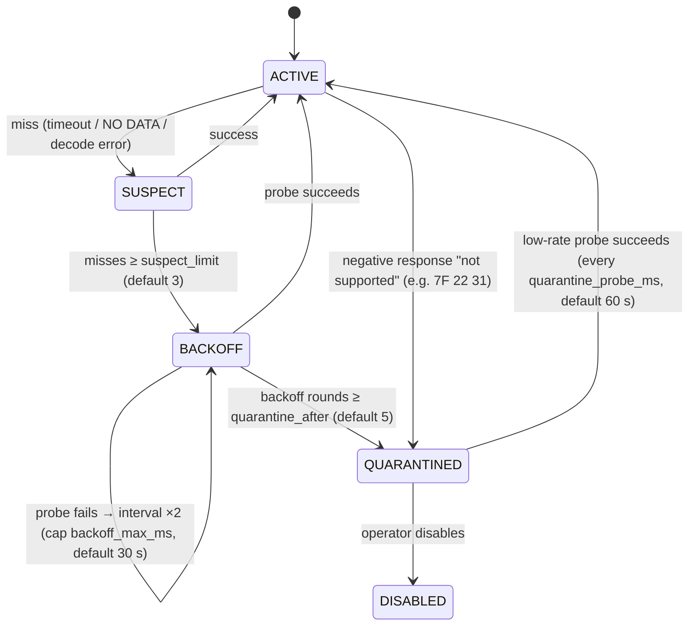
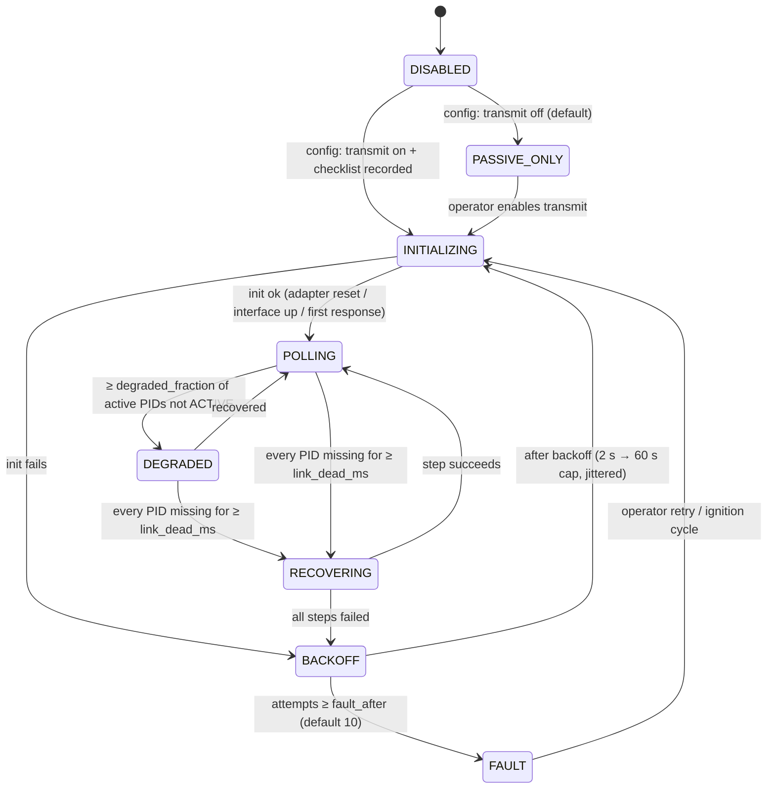

# Diagnostic communication: scheduling and recovery

Status: **design**. It is implemented in `services/vehicle-gateway` in Phase 3
and exercised against simulated faults. Hardware behaviour is unverified until
Phase 4.

This document answers one requirement:

> If a sensor stops updating, the system notices, says so, and recovers —
> without anyone unplugging the adapter — and without hammering the vehicle
> network while it tries.

## Field symptom

These were observed with Torque Pro and an OBDLink MX+, and also with FORScan
and an OBDLink EX:

- Individual readings, including EOT and ECT, freeze while others keep updating.
- Reseating the adapter often fixes it, sometimes without restarting the truck.

The causes are not known. The hypotheses and the experiment that tells them
apart are in [PROJECT_PLAN.md](../PROJECT_PLAN.md#diagnosing-the-intermittent-eotect-dropout).
The design below has to make each hypothesis **visible in the logs**, so
recovery never hides the evidence.

## Scheduler

This is a port of the tested ESP32 `PidScheduler`, with additions.

- **Priority classes.** 0 is RPM and boost; higher numbers are slower signals
  such as battery and baro.
- **Throughput budget.** The budget comes from measured requests per second for
  the active transport.
  - About 10 requests/s is measured for the MX+ on `7DF` with two responders.
  - The SocketCAN figure is to be measured.
  - When the enabled set oversubscribes the budget, lower priorities stretch
    first, and the stretch is reported as a health event. A gauge that promises
    10 Hz and delivers 2 Hz is a lie told to the driver.
- **One request in flight per transport.** This is the ELM's half-duplex rule,
  and the same discipline applies to ISO-TP.
- **Computed inputs are read together.** The inputs of a computed signal
  (EOT and ECT for EOT − ECT) are read back to back, and no snapshot goes out
  between them, so a stretched schedule can't put them more than
  `max_input_skew_ms` apart. Following never makes a slow input fast
  ([ADR-0018](adr/0018-computed-inputs-read-together.md)).
- **Adaptive intervals.** Stable, slowly changing signals may back off to their
  `max_interval_ms`. They return to the target interval on change.
- **Jittered retries.** A retry is bounded per request: one retry, then the
  failure counts against the PID.

## Per-PID state machine

- Each transition logs a structured event with these fields: PID, from, to,
  reason, counters, the last responder, and the last raw response.
- `BACKOFF` and `QUARANTINED` PIDs **cost almost no bus time**. Their probes come
  out of a small, separate budget.
- The sample keeps ageing into `STALE` throughout. The UI shows last-good plus
  age, and never shows a current value.

## Per-link state machine

### Recovery steps (escalating; each step is bounded and logged)

| Step | SocketCAN | OBDLink (ELM/STN) |
|---|---|---|
| 1. Soft | Drain and reset the ISO-TP socket | Send nothing and wait for the timed-out request's own `>` (1 s); if none, send `ATI` and wait for its answer. Never a bare CR: the ELM repeats the last command ([bench-log](../hardware/bench-log.md), 2026-11-02) |
| 2. Reset | Re-create the sockets. If the controller is bus-off, wait for `restart-ms` | `ATZ` and the full init sequence |
| 3. Reconnect | Interface down/up, done by the privileged helper | Close and reopen the RFCOMM or serial link |
| 4. Give up | `BACKOFF`, then eventually `FAULT`. The UI shows "Vehicle data unavailable" | Same |

Recovery has these guarantees:

- It never transmits faster than the normal budget.
- It never reboots the Pi.
- It never touches any other service.

A software watchdog in the gateway checks that the scheduler loop is still
making progress. A stuck loop is reported, then systemd's `WatchdogSec`
restarts the gateway process (only that process).

Implemented in `crates/sd-notify`; a frozen gateway was restarted on the Pi
**[BENCH]** (bench-log 2026-11-06). The progress gate itself is `[SIM]`: the control loop bumps a heartbeat
on every pass and on every request of a probe. A keep-alive (`WATCHDOG=1`)
goes out every half `WatchdogSec`, only if the heartbeat moved since the last
one; the first withheld one is logged. `f250-gateway.service` uses
`WatchdogSec=60`, well above the longest legitimate stall (one request with
the ELM recovery ladder behind it, ≈ 20 s). The recorder does the same with
`WatchdogSec=30`, and every wait it has on the gateway is bounded (10 s).

## Health and evidence

These are exposed through `f250.vehicle.v1.Health` and recorded:

- per PID: state, success and failure counters by kind, last success, last
  failure reason, last responder, latency percentiles
- per link: state, time in state, recovery counts by step, requests/s
  delivered against the budget
- the CAN controller (SocketCAN): bus state, error counters, bus-off count, RX
  overruns
- the adapter (OBDLink): unsolicited lines (`LV RESET`, `ACT ALERT`, `SLEEPING`),
  plus `STOPPED`, `BUFFER FULL` and `CAN ERROR` counts
- context for correlating with electrical causes: battery voltage, ignition
  state, uptime

The recorder keeps a **diagnostic event history** in SQLite: transitions,
recoveries and errors. Logging is rate-limited per event type, with suppressed
counts, so a flapping PID can't fill the disk.

## Transmit safety (ADR-007)

- The default is `PASSIVE_ONLY`. Nothing is transmitted at boot.
- An allow-list of request services is enforced in code before any frame
  leaves:
  - `01` (current data)
  - `03` (stored DTCs)
  - `07` (pending DTCs)
  - `09` (vehicle info)
  - `22` (read data by identifier)
  - `19` (read DTC information), if verified

  Anything else is rejected and logged. Services `10` (session change), `11`,
  `14`/`04` (clear DTCs), `27`, `2E`, `2F`, `31`, `34`–`37` and `3B` are refused.
- A single kill switch (config, or a UI developer toggle) stops all transmit
  immediately.
- Only one transport transmits at a time. Selecting another transport stops the
  first.
