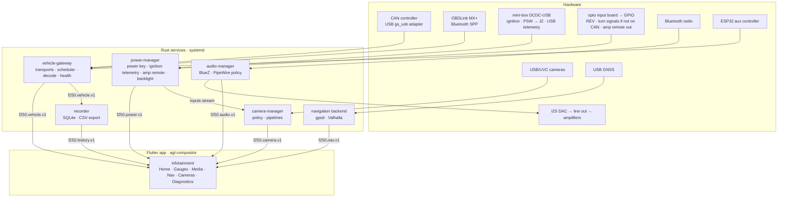
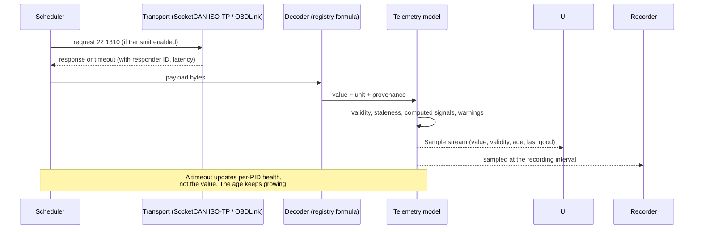
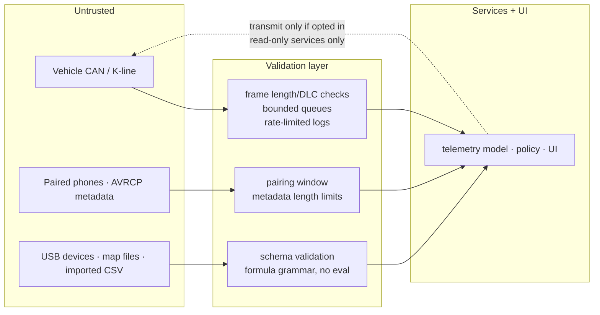

# Architecture overview

Status: **design.** Phase 1 wrote this design. Components are marked with the
phase that implements them. Nothing here is hardware-tested unless it says so.

Related:

- [telemetry model](telemetry-model.md)
- [diagnostic recovery](diagnostic-recovery.md)
- [power states](power-states.md)
- [camera policy](camera-policy.md)
- [audio routing](audio-routing.md)
- [ADRs](adr/)

## Principles

1. **Hardware, services and UI are separate layers.** The UI renders data and
   sends user intents. It never opens a CAN socket, a serial port or a GPIO line.
2. **One owner per hardware resource.**
   - `vehicle-gateway` owns the vehicle bus and adapters.
   - `power-manager` owns the GPIO inputs and outputs, the power key and the
     DCDC-USB's USB link.
   - `camera-manager` owns the V4L2 devices.
   - `audio-manager` owns the BlueZ policy.
3. **Versioned interfaces.** Protobuf packages are named `f250.<domain>.v1`.
   Breaking changes create `v2` alongside `v1`, and `buf breaking` enforces this
   in CI.
4. **The vehicle is untrusted input.** Every frame is length-checked, queues are
   bounded and logging is rate-limited (see the [trust boundaries](#trust-boundaries)).
5. **Degrade, don't die.** A failed service shows up as a status in the UI. The
   rest keeps running.

## Components

| Component | Language | Phase | Responsibility |
|---|---|---|---|
| `crates/telemetry` | Rust | 3 | Signal model, units, registry loader, safe formula grammar, staleness, computed signals, warnings |
| `crates/elm` | Rust | 3 | ELM327/STN client, a port of the tested C++ `ElmParser`/`ElmClient` |
| `services/vehicle-gateway` | Rust | 3–4 | Transports (simulated, SocketCAN, OBDLink), scheduler, recovery, health, API |
| `services/recorder` | Rust | 3 | Telemetry and event persistence, retention, export |
| `services/power-manager` | Rust | 6 | Power state machine, GPIO ownership, amplifier remote, backlight, day/night |
| `services/camera-manager` | Rust | 6 | Camera selection policy, capture pipelines |
| `services/audio-manager` | Rust | 6 | Pairing window, A2DP sink policy, AVRCP, volume limits |
| navigation backend | Rust + Valhalla | 6 | Position, routing (ADR-010) |
| `apps/infotainment` | Flutter 3.38.3 | 2 | The 800×480 UI, using simulated data first |
| `firmware/esp32` | C++ | existing | Auxiliary I/O: EGT, volume encoder, optional MX+ bridge |

## Data flow: one sensor reading

## Processes on the target

Each service is a systemd unit. The unit names are proposed and are implemented
in Phase 5.

| Unit | User | Notes |
|---|---|---|
| `f250-power-manager.service` | dedicated, `gpio` and `input` groups, plus a udev rule for the DCDC-USB | Starts first. Handles the power key (logind `HandlePowerKey=ignore`). `WatchdogSec` |
| `f250-vehicle-gateway.service` | dedicated, CAN access | Socket at `/run/f250/vehicle.sock`. Transmit is disabled unless config opts in |
| `f250-recorder.service` | dedicated | Writes `/var/lib/f250/` only |
| `f250-camera-manager.service` | dedicated, `video` group | |
| `f250-audio-manager.service` | dedicated, `bluetooth`/`audio` | |
| `can0` setup | systemd-networkd `.network` or a oneshot unit | Brings the interface up **listen-only** by default |
| Flutter app | AGL applaunchd template | Launched by agl-compositor / applaunchd |

Every service unit gets the same hardening:

- `ProtectSystem=strict`
- `ProtectHome=yes`
- `NoNewPrivileges=yes`
- `PrivateTmp=yes`
- the minimum `CapabilityBoundingSet`
- `RestrictAddressFamilies` limited to what the service needs (`AF_UNIX`, plus
  `AF_CAN` for the gateway, `AF_BLUETOOTH` for audio)

## API transport

gRPC over **Unix domain sockets** in `/run/f250/`. Access is controlled by the
socket file mode and group (ADR-002).

During development on macOS, the same services listen on a local socket or
loopback TCP. The Flutter app picks its data source from configuration:
simulated in-process, or gRPC.

## Trust boundaries

The only path back to the vehicle is the diagnostic request path. It is
disabled by default, restricted to read services, and rate-budgeted. See
[ADR-007](adr/0007-read-only-vehicle-access.md).

## Development and deployment topology

| Where | What runs |
|---|---|
| Mac | Flutter app (macOS desktop, 800×480 window) + Rust services with the simulated transport + firmware host tests |
| Linux CI / Docker | Same, plus Linux-only code (SocketCAN against `vcan`) |
| Linux x86_64 build host | Yocto / AGL image builds (ADR-004) |
| Pi 5 | Stage 1: the prebuilt AGL Vimba image with sideloaded binaries. Stage 2: the `meta-f250` image (ADR-005) |
