# Power management

Status: the power-key part is implemented in `services/power-manager`
(Phase 6.7) **[SIM]**: the state machine below, unit-tested transition by
transition, and smoke-tested with a fake key device. Not yet run on the Pi. The
camera switch, day/night and the backlight are still design.
The electrical behaviour is unverified until it is measured on the bench and in
the truck (Phase 7).

The hardware is a **mini-box DCDC-USB** in automotive mode
([ADR-0013](adr/0013-dcdc-usb-power-supply.md)), **pulse-only**: its USB port
isn't connected, so the Pi learns about the ignition only from the PSW pulse
(owner, 2026-11-09). Its documented behaviour and
gaps are in the
[compatibility matrix](../hardware/compatibility-matrix.md#mini-box-dcdc-usb).
The wiring is in [power-and-inputs.md](../wiring/power-and-inputs.md).

| Function | Source | Notes |
|---|---|---|
| Ignition | Radio-harness ACC → DCDC-USB **IGN** | The Pi doesn't see it. Only the supply's PSW pulse tells it the ignition went off |
| Power to the Pi | DCDC-USB **VOUT** at about 5 V → Pi 5 | Output is switched by the DCDC-USB's timers |
| Shutdown request | DCDC-USB **PSW** → Pi 5 **J2** pads | A momentary closure, the same as pressing the Pi's power button. Electrical form to be confirmed (H21) |
| Battery voltage | Not measured | The supply cuts power below 11.2 V during HARDOFF. No running measurement (H16) |
| Camera switch | 5-way switch → Pi GPIO | Read by power-manager (the GPIO owner), passed to camera-manager ([camera policy](camera-policy.md), [ADR-0024](adr/0024-camera-selection-switch-and-can-reverse.md)). Reverse itself comes from the gateway (HS-CAN), not from a wire |
| Amplifier remote | Radio-harness ACC → both amps' REM, no timer. **Not on the Pi** ([ADR-0014](adr/0014-multichannel-dac8x.md)) | Key-on turns the amps on while the Pi boots; key-off cuts them at once, before the Pi shuts down ([wiring](../wiring/audio.md#remote-turn-on-acc-straight-to-rem)) |
| Illumination | None | Day/night from sun position, see below |

## Goals

- Boot on ignition and shut down cleanly after the ignition goes off.
- Ride through cranking dips and short ignition blips without rebooting.
- Never drain the truck's batteries when parked:
  - The DCDC-USB's standby draw is documented as "well under 1 mA". It is
    still to be measured.
  - The Pi is unpowered once HARDOFF expires.
- Keep the DAC muted until the audio pipeline is up, and mute it before
  shutdown. The amplifiers themselves are switched by ACC, not by the Pi: they
  come on at key-on, while the Pi boots, and go off at key-off, before the Pi
  stops.
- Protect the filesystem: shut down cleanly, and keep the root filesystem
  read-only where possible (Phase 5). A hard cut must be survivable.

## How the DCDC-USB sequences power

The documented behaviour (Quick Installation Guide, p. 4):

1. **Ignition on.** The output comes on and the Pi 5 boots because it has
   power. The supply also sends an ON pulse, which a motherboard needs and the
   Pi does not. Its timing is undocumented (H21).
2. **Ignition off.** After **OFFDELAY**, the supply pulses PSW. That is the
   Pi's shutdown request.
3. **After the pulse.** The output stays on for **HARDOFF**, then is cut. If
   the battery falls below **11.2 V** during HARDOFF, the output is cut early.

The supply never learns whether the Pi actually halted, so **HARDOFF must be
longer than the worst measured shutdown time**, with margin.

The timers come from one of the supply's jumper presets (QIG p. 4; no USB).
The presets with a finite HARDOFF are 5 s / 60 s, 1 min / 1 min,
15 min / 1 min and 30 min / 1 min. A "never" HARDOFF would leave a halted Pi
drawing power. Example to tune:

| Timer | Example | Constraint |
|---|---|---|
| OFFDELAY | 1 min (preset 1 min / 1 min) | Longer than any ACC dropout while cranking (H22), and longer than `boot_key_ignore_s` so a quick key cycle's off-pulse isn't ignored. Longer means the screen survives a quick stop |
| HARDOFF | 1 min | Longer than the worst measured shutdown time. The manual suggests 1 minute for battery-sensitive installs |

## State machine

The Pi never decides on its own to halt because of the ignition. It follows
the supply's pulse, so there is only one timer authority.

```mermaid
stateDiagram-v2
  [*] --> STARTING: VOUT on (ignition on)
  STARTING --> STARTING: power key (the supply's ON pulse; ignored, logged)
  STARTING --> RUNNING: boot window over
  RUNNING --> SHUTTING_DOWN: power key (PSW pulse or the onboard button)
  RUNNING --> FAULT: GPIO lost / repeated service failure
  FAULT --> SHUTTING_DOWN: power key
  FAULT --> RUNNING: condition clears
  SHUTTING_DOWN --> OFF: poweroff
  OFF --> [*]: HARDOFF expires, VOUT cut
```

| State | Entry | Actions | Exit |
|---|---|---|---|
| `OFF` | Halt completes | Nothing runs. The supply cuts VOUT when HARDOFF expires | Ignition on, so VOUT on |
| `STARTING` | Boot | Claim the GPIO. Audio muted. **Ignore the power key** for `boot_key_ignore_s` (the supply's ON pulse) | The boot window is over. Only time ends it: a service that never gets ready must not stop the key-off pulse from working |
| `RUNNING` | The boot window ends | Audio unmutes once the pipeline is up. Backlight follows day/night | A power key, or a fault |
| `SHUTTING_DOWN` | Power key accepted | Mute, then stop services and sync, then `systemctl poweroff` | Halt |
| `FAULT` | GPIO lost, or repeated service failures | Report in the UI. The power key still works | Condition clears, or a power key |

Configuration defaults (every one is an example to tune):

| Setting | Default |
|---|---|
| `boot_key_ignore_s` | 30, until H21 measures when the ON pulse arrives. Must be shorter than OFFDELAY |

logind must not act on the power key itself: set `HandlePowerKey=ignore` in
`logind.conf`. power-manager reads the key from the input device and decides.

### Edge cases of a toggle signal

The PSW pulse means "press the button". It doesn't mean "be off". These cases
follow from that:

| Case | What happens | Handling |
|---|---|---|
| The ON pulse arrives after boot has started | Without handling, it would read as a shutdown request | Ignored during `boot_key_ignore_s`. A pulse after the window always shuts down |
| The Pi is already halted when the off-pulse arrives | The pulse **wakes** the Pi, then HARDOFF cuts it mid-boot | Avoid halting with the ignition on: the UI offers Restart, not Shut down. A mid-boot cut must be survivable (read-only root, Phase 5) |
| The ignition returns during OFFDELAY | Unknown whether the supply cancels its pulse (H23) | If it does, nothing happens. If it doesn't, the Pi shuts down with the key on |
| The ignition returns during HARDOFF | The Pi finishes halting while VOUT stays on, so the head unit stays dark until the next key cycle | Not handled: the Pi can't see the ignition. Whether the supply then sends an ON pulse, which would boot the Pi, is unknown (H23) |
| The Pi hangs | The pulse does nothing | HARDOFF cuts power anyway: the backstop |
| Someone presses the Pi's onboard button | Same as a PSW pulse | Same rules |

Halted draw: by default a halted Pi 5 draws about 1–1.4 W until HARDOFF cuts
it. `POWER_OFF_ON_HALT=1` lowers that to about 0.01 W. The docs don't say
whether the Pi then boots on its own when power is reapplied, so it stays at
the default until a bench test shows it does.

## Low voltage

- During HARDOFF, the DCDC-USB cuts power below 11.2 V (documented).
- While running there is no low-voltage shutdown (pulse-only, 2026-11-09).
  With ACC on, the head unit draws power as the old radio did. If one is
  wanted later, an ESP32 ADC with a divider is the measurement (H16). The
  PCM's battery-voltage PID is not usable with the ignition off.

## Crash and reset behaviour (to be verified on hardware)

- The amplifiers are on ACC, not on the Pi
  ([ADR-0014](adr/0014-multichannel-dac8x.md)), so **a Pi crash with the key on
  leaves them on**. Key-off always cuts them. Phase 6.2 must record what the
  speakers do with the amps on (H5):
  - after a kernel panic
  - after a watchdog reset

  Silence or a short pop is acceptable. A sustained buzz (the DAC repeating
  its last buffer) is not: then the remote goes back on a Pi output with a
  hardware timer that drops it when the Pi stops toggling a heartbeat.
- Watchdogs:
  - systemd `RuntimeWatchdogSec` drives the Pi's hardware watchdog
  - each service sets `WatchdogSec`
  - the power-manager restarts services and **does not** reboot the Pi for an
    application fault

## Day/night and brightness

- Inputs, in order of preference. There is no illumination wire
  ([ADR-0013](adr/0013-dcdc-usb-power-supply.md)).
  1. a sun-position calculation from GPS time and location
  2. a manual override
- Backlight: the original 7" display's backlight is regulator-based. Find it
  under `/sys/class/backlight/` on the Pi 5 at runtime; don't hard-code the
  path. A udev rule grants the power-manager write access.
- Brightness changes are ramped.
