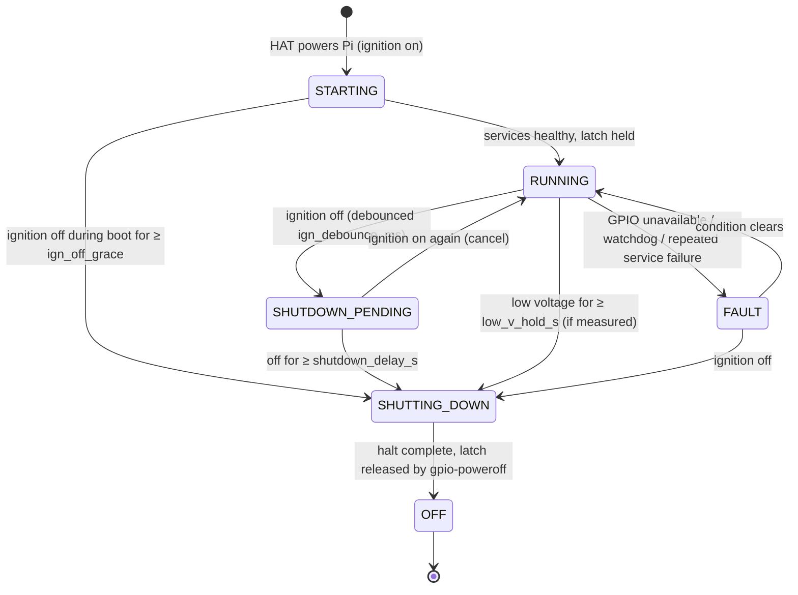

# Power management

Status: **design**. It is implemented in `services/power-manager` in Phase 6.
The electrical behaviour is unverified until it is measured on the bench and in
the truck (Phase 7).

The hardware assumptions come from the CarPiHAT PRO 5 documentation. See the
[compatibility matrix](../hardware/compatibility-matrix.md), where several
items are unverified for the PRO 5:

| Function | Pin | Notes |
|---|---|---|
| Ignition sense | BCM12 | Opto-isolated |
| Power latch | BCM25 | `gpio-poweroff` overlay keeps the latch low after halt |
| Amplifier remote | OUT_0 (BCM27) | 12 V high-side, 1 A |
| Illumination input | BCM13 | Drives day/night |

## Goals

- Boot on ignition and shut down cleanly after the ignition goes off.
- Ride through cranking dips and short ignition blips without rebooting.
- Never drain the truck's batteries when parked. The HAT draws under 1 mA when
  off; this is the documented figure and is to be measured.
- Mute the audio before the amplifiers switch on and before they switch off, so
  there is no pop.
- Protect the filesystem: shut down cleanly, and keep the root filesystem
  read-only where possible (Phase 5).

## State machine

| State | Entry | Actions | Exit |
|---|---|---|---|
| `OFF` | Halt completes | Latch released; the HAT cuts power | The HAT powers the Pi on ignition |
| `STARTING` | Boot | Claim GPIO. Assert the latch. Amp remote **off**. Audio muted | All core services report ready |
| `RUNNING` | Startup completes | Audio unmutes, then a settle delay, then the amp remote turns on. Backlight follows day/night | Ignition off, low voltage, or a fault |
| `SHUTDOWN_PENDING` | Ignition off (debounced) | Keep running. Show a countdown banner. Recorder flushes | Ignition returns (**cancel**), or the delay expires |
| `SHUTTING_DOWN` | Delay expired, or low voltage | Mute, then amp remote off, then a delay, then stop services, sync, `systemctl poweroff` | Halt |
| `FAULT` | GPIO lost, or repeated failures | Report in the UI. Keep the latch. Amp remote off | Condition clears, or ignition goes off |

Defaults are configurable, and every one is an example to tune:

| Setting | Default |
|---|---|
| `ign_debounce_ms` | 500 |
| `shutdown_delay_s` | 10 (the HAT example script uses 10 s) |
| `ign_off_grace` | 5 s |

Low-voltage shutdown needs an actual voltage measurement. The HAT doesn't
document one, so the source is still to be chosen:

- an ESP32 ADC with a divider
- an I2C ADC
- the PCM's battery-voltage PID while the engine computer is awake (not
  usable with the ignition off)

## Crash and reset behaviour (to be verified on hardware)

- The amp remote output is the risk: a Pi crash must not leave the amplifiers
  on, producing noise. Phase 6.2 must measure what OUT_0 does in each of these
  cases:
  - after a kernel panic
  - after a watchdog reset
  - with the GPIO line released

  The required result is that the output goes off. If the HAT's default doesn't
  guarantee that, add a pull-down, or a hardware timer that drops remote turn-on
  when the Pi stops toggling a heartbeat.
- Watchdogs:
  - systemd `RuntimeWatchdogSec` drives the Pi's hardware watchdog
  - each service sets `WatchdogSec`
  - the power-manager restarts services and **does not** reboot the Pi for an
    application fault

## Day/night and brightness

- Inputs, in order of preference:
  1. the illumination wire (BCM13, the headlamp-on signal)
  2. a sun-position calculation from GPS time and location
  3. a manual override
- Backlight: the original 7" display's backlight is regulator-based. Find it
  under `/sys/class/backlight/` on the Pi 5 at runtime; don't hard-code the
  path. A udev rule grants the power-manager write access.
- Brightness changes are ramped.
