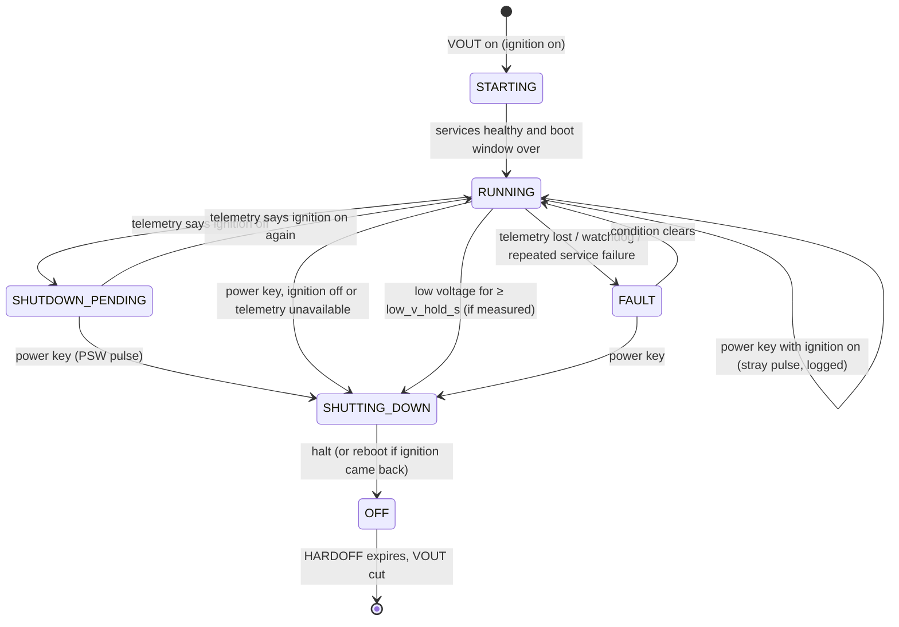

# Power management

Status: **design**. It is implemented in `services/power-manager` in Phase 6.
The electrical behaviour is unverified until it is measured on the bench and in
the truck (Phase 7).

The hardware is a **mini-box DCDC-USB** in automotive mode
([ADR-0013](adr/0013-dcdc-usb-power-supply.md)). Its documented behaviour and
gaps are in the
[compatibility matrix](../hardware/compatibility-matrix.md#mini-box-dcdc-usb).
The wiring is in [power-and-inputs.md](../wiring/power-and-inputs.md).

| Function | Source | Notes |
|---|---|---|
| Ignition | Radio-harness ACC → DCDC-USB **IGN** | The Pi doesn't see it directly. power-manager reads it over USB (H24) |
| Power to the Pi | DCDC-USB **VOUT** at about 5 V → Pi 5 | Output is switched by the DCDC-USB's timers |
| Shutdown request | DCDC-USB **PSW** → Pi 5 **J2** pads | A momentary closure, the same as pressing the Pi's power button. Electrical form to be confirmed (H21) |
| Battery voltage | DCDC-USB input voltage, over USB | H24. Fallback: an ESP32 ADC (H16) |
| Reverse input | Opto board → Pi GPIO | Owned by power-manager, passed to camera-manager ([camera policy](camera-policy.md)) |
| Amplifier remote | Radio-harness ACC → delay-on timer relay → both amps' REM. **Not on the Pi** ([ADR-0014](adr/0014-multichannel-dac8x.md)) | Key-off cuts the amps at once, before the Pi shuts down ([wiring](../wiring/audio.md#remote-turn-on-acc-through-a-delay-on-timer)) |
| Illumination | None | Day/night from sun position, see below |

## Goals

- Boot on ignition and shut down cleanly after the ignition goes off.
- Ride through cranking dips and short ignition blips without rebooting.
- Never drain the truck's batteries when parked:
  - The DCDC-USB's standby draw is documented as "well under 1 mA". It is
    still to be measured.
  - The Pi is unpowered once HARDOFF expires.
- Keep the DAC muted until the audio pipeline is up, and mute it before
  shutdown. The amplifiers themselves are switched by ACC through a delay-on
  timer, not by the Pi: they come on after the Pi has booted and go off at
  key-off, before the Pi stops.
- Protect the filesystem: shut down cleanly, and keep the root filesystem
  read-only where possible (Phase 5). A hard cut must be survivable.

## How the DCDC-USB sequences power

The documented behaviour (Quick Installation Guide, p. 4):

1. **Ignition on.** The output comes on and the Pi 5 boots because it has
   power. The supply also sends an ON pulse, which a motherboard needs and the
   Pi does not. Its timing is undocumented (H21).
2. **Ignition off.** After **OFFDELAY**, the supply pulses PSW. That is the
   Pi's shutdown request.
3. **After the pulse.** The output stays on for **HARDOFF**, then is cut. If
   the battery falls below **11.2 V** during HARDOFF, the output is cut early.

The supply never learns whether the Pi actually halted, so **HARDOFF must be
longer than the worst measured shutdown time**, with margin.

Example timer settings (configuration, set over USB, and examples to tune):

| Timer | Example | Constraint |
|---|---|---|
| OFFDELAY | 30 s | Longer than any ACC dropout while cranking (H22). Longer means the screen survives a quick stop |
| HARDOFF | 60 s | Longer than the worst measured shutdown time. The manual suggests 1 minute for battery-sensitive installs |

## State machine

The Pi never decides on its own to halt because of the ignition. It follows
the supply's pulse, so there is only one timer authority.

| State | Entry | Actions | Exit |
|---|---|---|---|
| `OFF` | Halt completes | Nothing runs. The supply cuts VOUT when HARDOFF expires | Ignition on, so VOUT on |
| `STARTING` | Boot | Claim the GPIO. Audio muted. **Ignore the power key** for `boot_key_ignore_s` (the supply's ON pulse) | All core services report ready and the boot window is over |
| `RUNNING` | Startup completes | Audio unmutes once the pipeline is up. Backlight follows day/night | Ignition off (telemetry), a power key, low voltage, or a fault |
| `SHUTDOWN_PENDING` | Telemetry says ignition off | Keep running. Show a countdown banner, using the supply's off-delay timer if it is readable. Recorder flushes | Ignition returns (**cancel**), or the PSW pulse arrives |
| `SHUTTING_DOWN` | Power key accepted, or low voltage | Mute, then stop services and sync. Last check: if telemetry says the ignition is on again, `systemctl reboot`; otherwise `systemctl poweroff` | Halt or reboot |
| `FAULT` | Telemetry lost, GPIO lost, or repeated failures | Report in the UI. Fall back to **pulse-only**: any power key outside the boot window shuts down | Condition clears, or a power key |

Configuration defaults (every one is an example to tune):

| Setting | Default |
|---|---|
| `boot_key_ignore_s` | 30, until H21 measures when the ON pulse arrives |
| `low_v_hold_s` | 30 |
| `telemetry_poll_ms` | 1000 |

logind must not act on the power key itself: set `HandlePowerKey=ignore` in
`logind.conf`. power-manager reads the key from the input device and decides.

### Edge cases of a toggle signal

The PSW pulse means "press the button". It doesn't mean "be off". These cases
follow from that:

| Case | What happens | Handling |
|---|---|---|
| The ON pulse arrives after boot has started | Without handling, it would read as a shutdown request | Ignored during `boot_key_ignore_s`. If telemetry says the ignition is on, it is ignored at any time |
| The Pi is already halted when the off-pulse arrives | The pulse **wakes** the Pi, then HARDOFF cuts it mid-boot | Avoid halting with the ignition on: the UI offers Restart, not Shut down. A mid-boot cut must be survivable (read-only root, Phase 5) |
| The ignition returns during HARDOFF | The Pi finishes halting while VOUT stays on, so the head unit stays dark until the next key cycle | The reboot-instead-of-halt check covers part of the window. Whether the supply then sends an ON pulse is unknown (H23) |
| The Pi hangs | The pulse does nothing | HARDOFF cuts power anyway: the backstop |
| Someone presses the Pi's onboard button | Same as a PSW pulse | Same rules |

Halted draw: by default a halted Pi 5 draws about 1–1.4 W until HARDOFF cuts
it. `POWER_OFF_ON_HALT=1` lowers that to about 0.01 W. The docs don't say
whether the Pi then boots on its own when power is reapplied, so it stays at
the default until a bench test shows it does.

## Low voltage

- During HARDOFF, the DCDC-USB cuts power below 11.2 V (documented).
- While running, a low-voltage shutdown needs a measurement. In order of
  preference:
  1. the DCDC-USB's input voltage over USB (H24)
  2. an ESP32 ADC with a divider (H16)

  The PCM's battery-voltage PID is not usable with the ignition off.

## Crash and reset behaviour (to be verified on hardware)

- The amplifiers are on ACC through a delay-on timer, not on the Pi
  ([ADR-0014](adr/0014-multichannel-dac8x.md)), so **a Pi crash with the key on
  leaves them on**. Key-off always cuts them. Phase 6.2 must record what the
  speakers do with the amps on (H5):
  - after a kernel panic
  - after a watchdog reset

  Silence or a short pop is acceptable. A sustained buzz (the DAC repeating
  its last buffer) is not: then the remote goes back on a Pi output with a
  hardware timer that drops it when the Pi stops toggling a heartbeat.
- Watchdogs:
  - systemd `RuntimeWatchdogSec` drives the Pi's hardware watchdog
  - each service sets `WatchdogSec`
  - the power-manager restarts services and **does not** reboot the Pi for an
    application fault

## Day/night and brightness

- Inputs, in order of preference. There is no illumination wire
  ([ADR-0013](adr/0013-dcdc-usb-power-supply.md)).
  1. a sun-position calculation from GPS time and location
  2. a manual override
- Backlight: the original 7" display's backlight is regulator-based. Find it
  under `/sys/class/backlight/` on the Pi 5 at runtime; don't hard-code the
  path. A udev rule grants the power-manager write access.
- Brightness changes are ramped.
