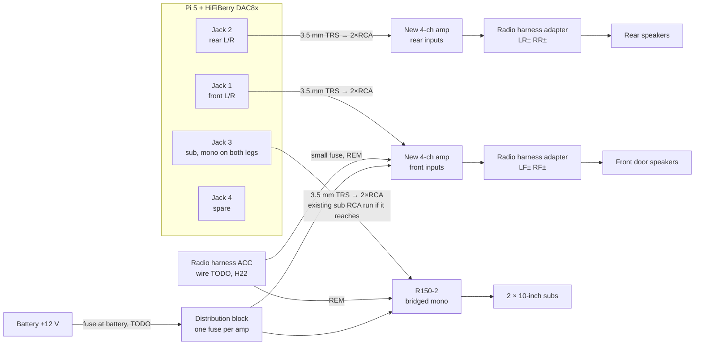

# Audio: the Pi to the amplifiers, speakers and subwoofers

**Status: DESIGN, NOT VERIFIED. Nothing here has been bought or connected.** A
person must check every line against the truck, the DAC and both amplifiers,
and sign it off in [bench-log.md](../hardware/bench-log.md), before it is
installed ([safety gates](../safety/assumptions.md#human-verification-gates)).

Decision: [ADR-0014](../architecture/adr/0014-multichannel-dac8x.md). Behaviour
and software: [audio-routing.md](../architecture/audio-routing.md). Part facts:
[compatibility matrix](../hardware/compatibility-matrix.md#hifiberry-dac8x).

## What changes when the Pioneer comes out

The Pioneer DEH-P770MP does three audio jobs today (owner, 2026-11-04):

| Job today | Done by | After the swap |
|---|---|---|
| Drives the 4 factory speakers (SuperCab: front doors and rear) | The Pioneer's built-in amplifier | A **new 4-channel amplifier**, fed by the Pi |
| Feeds the subwoofer amp | The Pioneer's sub pre-out → **Rockford Fosgate Prime R150-2**, bridged mono into two 10" subs | The Pi's own sub output → the same R150-2 |
| Fader, sub level, crossover | The Pioneer's menus | Software on the Pi (PipeWire), set from the touchscreen |

**The Pi never drives a speaker.** It has line-level outputs only. Every
speaker is driven by an amplifier.

**No RCA Y-splitters.** The DAC has separate outputs for front, rear and sub,
so each amplifier input gets its own signal.

## Overview

## Channel map

This is configuration in audio-manager, not hardware. Which DAC8x jack carries
which ALSA channel pair is **TODO**. HiFiBerry doesn't publish it, so identify
each jack with a test tone on the bench.

| DAC8x jack | Feeds | Content |
|---|---|---|
| 1 | 4-ch amp, front inputs | Front left/right, high-passed |
| 2 | 4-ch amp, rear inputs | Rear left/right, high-passed. The fader moves level between jacks 1 and 2 |
| 3 | R150-2 RCA inputs | Left+right summed to mono, sent on **both** legs, low-passed. Sub level is set here |
| 4 | Nothing | Spare |

The crossover frequency is example configuration (for example 80 Hz), not a
recommended value ([CLAUDE.md rule 10](../../CLAUDE.md#thresholds)). Tune it in
the truck by ear and with a meter.

## Connections

| From | To | Notes |
|---|---|---|
| DAC8x jack 1 | New 4-ch amp **front** RCA inputs | 3.5 mm TRS → 2×RCA lead. Set the amp's input mode to **4-channel** (not 2-channel/bridged-input) |
| DAC8x jack 2 | New 4-ch amp **rear** RCA inputs | Same kind of lead |
| DAC8x jack 3 | R150-2 RCA inputs | Reuse the existing sub RCA run from the dash if it reaches; a 3.5 mm → RCA female adapter joins them. Whether the R150-2 in bridged mode reads both inputs or only one: **TODO from its manual** ([H28](../hardware/open-questions.md)). The same mono signal on both legs covers either case |
| New 4-ch amp speaker outputs | Radio harness adapter: LF±, RF±, LR±, RR± | These are the wires the Pioneer's speaker outputs used, so the factory speaker wiring is reused. Wire colours: **TODO**, from the existing adapter's label and confirmed with a 1.5 V battery "pop" test or a test tone. Keep + and − the same on all four (polarity check below) |
| Battery +12 V | Fuse within about 18 in (45 cm) of the battery → power wire → new 4-ch amp B+ | Gauge and fuse rating: **TODO**, from the chosen amp's manual. If the R150-2's existing power wire is large enough for both amps, a distribution block with **one fuse per amp** can split it instead ([H28](../hardware/open-questions.md)) |
| New 4-ch amp GND | Bare chassis metal, short run | Ideally the same ground point as the R150-2, to avoid alternator whine (below) |
| Radio harness **ACC** | Small inline fuse → 4-ch amp **REM** and R150-2 **REM** | The same ACC wire that feeds the DCDC-USB's IGN ([power-and-inputs.md](power-and-inputs.md)); which wire: **TODO** ([H22](../hardware/open-questions.md)). Replaces the Pioneer's remote lead (usually blue/white on aftermarket harnesses; **TODO**, check the Pioneer's harness). Fuse rating: **TODO**, from both amps' REM draw (from their manuals). **The Pi isn't connected to this at all** ([ADR-0014](../architecture/adr/0014-multichannel-dac8x.md)) |

## Remote turn-on: ACC straight to REM

The amplifiers' remote leads are switched by the key, not the Pi. ACC goes
straight to both REM terminals, with no timer (owner, 2026-11-09):

| Moment | What happens |
|---|---|
| Key to ACC/RUN | The amps turn on at once. The Pi starts booting, so the DAC8x initialises with the amps on: any pop or DC step it makes reaches the speakers ([H6](../hardware/open-questions.md), check 3) |
| Cranking | If ACC drops while cranking ([H22](../hardware/open-questions.md)), the amps drop out with it and come back when it returns |
| Key off (ACC drops) | The amps turn off **at once**. The Pi keeps running and shuts down later on the DCDC-USB's timers, so the amps are always off before the DAC stops: no key-off pop |
| Ford accessory delay keeps ACC on after key-off | The amps stay on with the Pi still running, until ACC drops |
| Pi crash with the key on | **The amps stay on.** Usually that's silence. The worst case is the DAC repeating its last buffer as a buzz until key-off ([H5](../hardware/open-questions.md)). Key-off always ends it |

If check 3 finds an audible pop at power-up, put a 12 V delay-on timer relay
(normally-open contact rated for both REM inputs) between ACC and the REM
leads, with its delay above the measured boot-to-audio time. Nothing changes
on the Pi ([ADR-0014](../architecture/adr/0014-multichannel-dac8x.md)).

Don't use the DCDC-USB's **Vaux** for this. Its manual calls it an
"unregulated switched input" without saying when it switches. If it follows the
supply's off-delay, the amps would stay on through the Pi's shutdown.

## GPIO budget with the DAC8x

The DAC8x overlay in the Raspberry Pi kernel
(`hifiberry-dac8x-overlay.dts`, `rpi-6.12.y`) claims:

- **BCM18–27** for the multichannel I2S
- **BCM5**, read by the driver to detect the optional ADC8x add-on (`hasadc-gpio`, active-low)

The GPIO inputs are the camera switch's five contacts, proposed on BCM6, 12,
13, 16 and 17 ([power-and-inputs.md](power-and-inputs.md#camera-switch),
[ADR-0024](../architecture/adr/0024-camera-selection-switch-and-can-reverse.md)),
clear of the DAC8x. **Leave BCM5 unconnected**, so the driver never sees a
false "ADC present".

Whether the DAC8x passes the 40-pin header through, so the camera switch can
reach its pins with the HAT fitted: **TODO**
([H27](../hardware/open-questions.md)). If it doesn't, use a stacking header or
a GPIO breakout.

## Alternator whine and ground loops

- **Cause:** the Pi's ground comes through the DCDC-USB near the radio, and
  each amplifier is grounded somewhere else. The RCA shields join the two, so
  current flows through them.
- **Avoid it first:**
  - ground both amps at one point
  - keep the RCA runs away from the amp power wire (opposite sides of the cab)
  - keep the Pi's DCDC-USB ground short
- **If it whines anyway:** a ground-loop isolator on the RCA lines. Test it in
  the truck with the engine running before buying more than one.

## Gain staging

1. Amp gains fully down. Amp crossovers **off or flat**, because the Pi does
   the crossover. One alternative: as a backstop, set the R150-2's low-pass a
   little above the software crossover. Its bass EQ (0–12 dB at 45 Hz, per a
   retailer listing) stays at 0 unless it's wanted.
2. On the Pi, set volume to the configured **maximum** and play a 0 dBFS test
   tone.
3. Raise each amp's gain until just before audible distortion or the clipping
   indicator, with the speakers connected. The factory speakers' power
   handling is unknown ([H29](../hardware/open-questions.md)); stop well below
   the new amp's rating.
4. Then the Pi's volume cap, not the amp gain, limits loudness.

## Checks before sign-off

| # | Check | Expected | Result |
|---|---|---|---|
| 1 | DAC8x: test tone on each ALSA channel pair, identify jacks 1–4 | Channel map filled in above | |
| 2 | DAC8x line level: 0 dBFS 1 kHz into a meter on each jack | About 2.1 Vrms or less (documented maximum) | |
| 3 | DAC8x at power-up and shutdown, on a scope, amps disconnected | Record any pop or DC step (H6) | |
| 4 | Amps connected: key on, crank, key off, listening at each step | No pop at key-on while the Pi boots (H6); amps off the moment ACC drops (H22) | |
| 4a | With the amps on: force a kernel panic and a watchdog reset | Record what the speakers do: silence, a pop or a buzz (H5) | |
| 5 | Factory speaker DC resistance at the harness, one per channel, amp disconnected | Record it; about 3.2 Ω usually means a 4 Ω speaker (H29) | |
| 6 | Each speaker's channel and polarity (test tone, fader, battery pop test) | All four in phase; fader moves front ↔ rear | |
| 7 | R150-2 bridged input wiring, from its manual | Recorded (H28) | |
| 8 | Engine running, volume at zero, then music | No alternator whine | |
| 9 | Sub level and crossover from the touchscreen | Audible change, no clipping at the volume cap | |

Signed off by: _____ Date: _____
