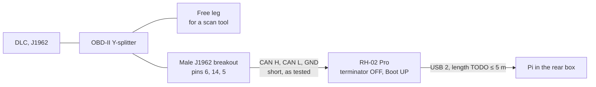

# HS-CAN: the permanent connection

**Status: DESIGN, NOT VERIFIED.** The temporary hookup it builds on is
signed off ([dlc-can-adapter.md](dlc-can-adapter.md)); this permanent
version is not. A person must check it and sign it off in
[bench-log.md](../hardware/bench-log.md) before it is installed
([safety gates](../safety/assumptions.md#human-verification-gates)).

Direct CAN is the head unit's only vehicle data path
([ADR-0011 amendment](../architecture/adr/0011-mx-plus-trial-first.md#amendment-direct-can-only-owner-2026-11-16),
[ADR-0012](../architecture/adr/0012-direct-can-usb-adapter.md)).

## Design: the adapter stays at the DLC, USB runs to the box

Why this way:

- **Nothing is cut or spliced.** The truck's wiring is unchanged, and the
  whole thing unplugs (ADR-0007: the truck stays independent of the head
  unit).
- **The CAN side stays exactly as tested.** The breakout and adapter at the
  DLC are what ran on the truck from 2026-11-07, with the bus still reading
  about 60 Ω. The long run to the box is USB, not an added CAN stub.
- **The DLC stays usable.** The Y-splitter's free leg takes a scan tool.

| From | To | Notes |
|---|---|---|
| DLC | Y-splitter | The owner has one (2026-11-03). Its pinout passes 6, 14, 5 straight through: **TODO**, check with a meter (only the breakout's pinout was checked) |
| Y-splitter leg | Male J1962 breakout → RH-02 Pro CAN H, CAN L, GND | As [dlc-can-adapter.md](dlc-can-adapter.md#connections): 6 → CAN H, 14 → CAN L, 5 → GND; the adapter's **5V terminal unconnected**; DLC 4 and 16 not connected |
| RH-02 Pro | Pi USB (directly, or the hub) | USB 2 passive cable. Length from the DLC to the box: **TODO**, measured in the truck; passive USB 2 reaches about 5 m |
| RH-02 Pro switches | — | Terminator **off (up)**, Boot **up** |

**Mounting.** The adapter and the splitter are fixed under the dash, clear
of the pedals and of the driver's knees, with the cables tied so a foot or
a knee can't pull them. Where exactly: **TODO**, in the truck. The adapter
is a small enclosure with a screw terminal block: cover the terminals so
nothing metal can bridge them.

**Not chosen: splicing into the HS-CAN pair behind the DLC.** It would free
the DLC, but it cuts the truck's wiring, needs the pair's wire colours from
Ford's wiring diagram (**not known to this project**), and makes the
adapter's stub longer. Revisit only with a reason and an ADR.

## A scan tool on the free leg

The gateway polls on its own from power-on (`CAN_AUTO_ACTIVE=1`, ADR-0007
amendment 2026-11-10). A scan tool on the free leg would then share the bus
with a second tester sending requests. Before plugging one in, either:

- unplug the breakout's lead from the Y-splitter (the readings then go
  stale on the screen, marked as stale; nothing else changes), or
- over SSH, `f250-can listen`. It stays listen-only until `f250-can active`
  or the next boot, when `f250-can-auto` goes active again after its clean
  listen.

This is a procedure, not enforced by anything. Put it in
[troubleshooting.md](../setup/troubleshooting.md) once installed.

## Checks before sign-off

| # | Check | Expected | Result |
|---|---|---|---|
| 1 | Y-splitter: continuity DLC side → each leg, pins 6, 14, 5, 4, 16 | Straight through | |
| 2 | Ignition off, everything connected (splitter, breakout, adapter, switch up): DLC 6–14 at the splitter's free leg | ≈ 60 Ω, not ≈ 40 Ω | |
| 3 | Adapter's 5V terminal | Unconnected | |
| 4 | USB run length | ≤ 5 m passive, or an active cable | |
| 5 | Drive with the gateway polling: `f250-can status` and the gateway's journal | No bus errors, no quarantines (as the 2026-11-08 drives) | |
| 6 | Pedals, steering column and the driver's knees clear of the adapter and cables | Clear | |

Signed off by: _____ Date: _____
