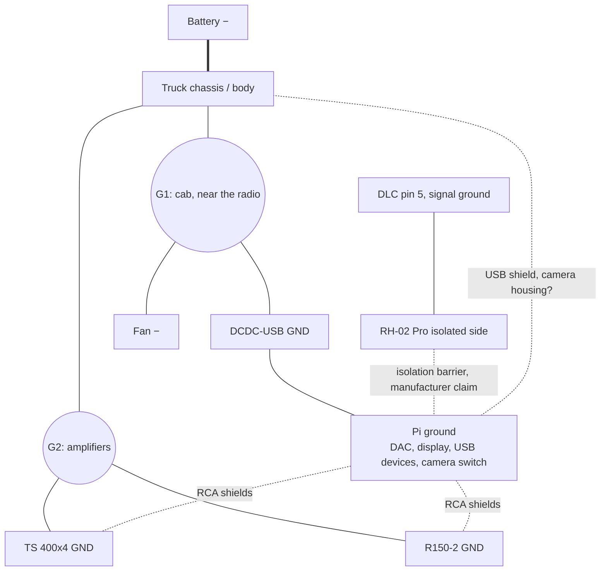

# Grounds, fuses and input protection

**Status: DESIGN, NOT VERIFIED. Nothing here is installed.** A person must
check every line against the truck and the parts, and sign it off in
[bench-log.md](../hardware/bench-log.md), before it is installed
([safety gates](../safety/assumptions.md#human-verification-gates)).

Connections by number (W1…W22) are in [system-overview.md](system-overview.md#every-connection).

## Ground points

Two chassis ground points, each a short run to bare metal, plus the
isolated CAN adapter, which has no ground path to the truck through the Pi.

| Point | What connects | Rule | Status |
|---|---|---|---|
| **G1**, cab, near the radio | DCDC-USB GND (W2), the box fan's − (W21) | The Pi's **only** intended ground to the truck. Bare metal, star washer, short wire | Location TODO, chosen in the truck |
| **G2**, amplifiers | TS 400x4 GND, R150-2 GND (W20) | Both amps on **one** point, to avoid alternator whine ([audio.md](audio.md#alternator-whine-and-ground-loops)). Wire as heavy as each amp's power wire | Where the R150-2 is grounded today: TODO (H28). Where the TS 400x4 goes: H37 |
| DLC pin 5 | RH-02 Pro GND (isolated side) | The transceiver's reference only. **DLC pin 4 (chassis) is not connected.** The adapter is galvanically isolated, so this is not a second ground for the Pi | Manufacturer claim, not measured ([dlc-can-adapter.md](dlc-can-adapter.md)) |

**Unavoidable second paths**, to know about:

- **The RCA shields** join the Pi's ground (G1) to the amps' ground (G2).
  This is the classic whine path. Keep G1 and G2 low-resistance to the body,
  keep the RCA runs away from the amp power wire, and use a ground-loop
  isolator only if it whines anyway ([audio.md](audio.md#alternator-whine-and-ground-loops)).
- **USB cameras mounted on the body.** A camera whose metal housing or
  mount touches the body joins the body to the Pi's ground through the USB
  cable's shield. Whether each camera's housing is isolated from its USB
  ground: **TODO**, with a meter, once the cameras are chosen (H33).

## Fuses

Every branch from the battery or ACC has its own fuse, close to where it
taps the feed. **Ratings marked TODO are not chosen: they come from each
part's manual or a measured load, never from this sheet.**

| Fuse | Feed | Protects | Rating and wire | Source |
|---|---|---|---|---|
| F1 | Battery +12 V constant → DCDC-USB VIN (W1) | The VIN wire | **TODO** from the measured load (H25). The DCDC-USB also has its own 10 A blade fuse | QIG p. 5 ([matrix](../hardware/compatibility-matrix.md#mini-box-dcdc-usb)) |
| F2 | ACC → DCDC-USB IGN (W3) | The IGN wire | **TODO**. IGN is a sense input, so the fuse is sized for the wire | — |
| F3 | ACC → both amps' REM (W19) | The REM wire | **TODO** from both amps' REM draw (their manuals) | [audio.md](audio.md#connections) |
| F4 | Battery +12 V → TS 400x4 B+ (W18), within about 18 in (45 cm) of the battery | The amp's power wire | 20 A in 11 AWG for runs up to 4 m, as recorded from the TS 400x4 manual in [ADR-0047](../architecture/adr/0047-head-unit-enclosure.md). **Check against the manual before buying.** Or a distribution block from the R150-2's feed, one fuse per amp (H28) | ADR-0047 |
| F5 | Battery +12 V → R150-2 (existing) | Existing | Unchanged. Record its rating and gauge (H28) | — |
| F6 | ACC → box fan + (W21) | The fan wire | **TODO** from the fan's current | [ADR-0047](../architecture/adr/0047-head-unit-enclosure.md) decision 7 |

The ACC wire then feeds three branches (F2, F3, F6). Its own capacity, and
the fuse already on it in the truck, must cover all three: **TODO**, from the
truck's wiring diagram and the parts' draw (H22).

## External TVS: not fitted

**Decision (owner, 2026-11-16): rely on the DCDC-USB's own input
protection; no external TVS** ([ADR-0013 amendment](../architecture/adr/0013-dcdc-usb-power-supply.md#amendment-no-external-tvs-owner-2026-11-16)).
The plan had one from the CarPiHAT days, when that board's input protection
wasn't published. The DCDC-USB's is partly documented:

| What the DCDC-USB documents | Status |
|---|---|
| Input 6–34 V; electronic shutdown at 34 V; clamping at 35–37 V | V (QIG p. 5) |
| How much energy the clamp absorbs, or a load-dump rating against a named standard | **Not documented** (U) |
| Reverse-polarity protection | **Not documented** (U) |

- **Risk accepted:** a transient larger than the DCDC-USB's clamp can absorb
  reaches it, and possibly the Pi. How large that is, is unknown.
- **Reverse polarity** is caught by a meter check before the DCDC-USB is
  plugged in ([power-and-inputs.md](power-and-inputs.md#checks-before-sign-off), check 1a).
- **Revisit** if a DCDC-USB or the Pi is damaged after a supply transient:
  then a TVS goes after F1, across VIN and G1, chosen for its stand-off
  voltage, its clamping voltage against what the DCDC-USB tolerates, and its
  power rating, with F1 opening before it fails.

## Checks before sign-off

| # | Check | Expected | Result |
|---|---|---|---|
| 1 | G1 and G2: resistance to battery −, ignition off, battery − connected | Record it; well under 1 Ω | |
| 2 | G1 to battery − with the engine running and the head unit on: DC voltage | Record it | |
| 3 | DLC pin 5 to the Pi's ground, adapter connected, Pi off | Open (isolation), or record what it reads | |
| 4 | Each USB camera: housing to its USB ground | Record it (isolated or not) | |
| 5 | Every fuse in the table above fitted, rating matching the decided value | As decided | |
| 6 | ACC wire's existing fuse and capacity against F2 + F3 + F6 | Enough for all three | |

Signed off by: _____ Date: _____
