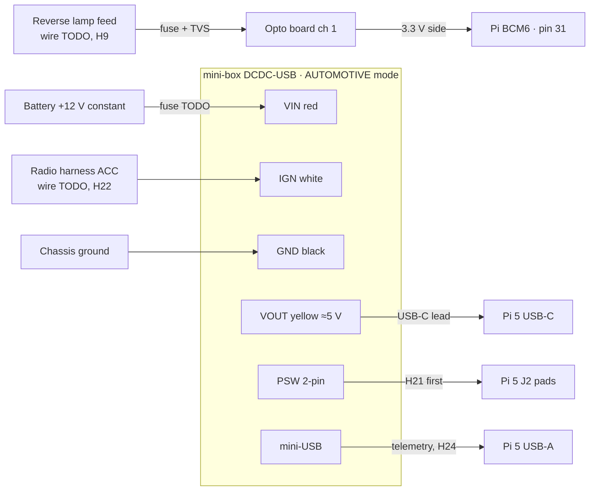

# Power (DCDC-USB) and the reverse input

**Status: DESIGN, NOT VERIFIED. Nothing here has been connected yet.** A person
must check every line against the truck, the DCDC-USB and the opto board, and
sign it off in [bench-log.md](../hardware/bench-log.md), before it is installed
([safety gates](../safety/assumptions.md#human-verification-gates)).

This is the permanent power and input design from
[ADR-0013](../architecture/adr/0013-dcdc-usb-power-supply.md). Behaviour:
[power-states.md](../architecture/power-states.md). Documented facts about the
parts: [compatibility matrix](../hardware/compatibility-matrix.md#mini-box-dcdc-usb).

> **The DCDC-USB's default output is 12 V.** Set VOUT to about 5 V, and
> **measure it with a meter, before the Pi is connected**. 12 V into the Pi
> destroys it.

## Overview

## Connections

| From | To | Notes |
|---|---|---|
| Battery +12 V, constant | Inline fuse → DCDC-USB **VIN** (red) | Fuse rating and wire gauge: **TODO**, from the measured load ([H25](../hardware/open-questions.md)). The DCDC-USB also has its own 10 A blade fuse. If this comes from the radio harness's constant feed, first check that feed's fuse rating against the load |
| Chassis ground, near the radio | DCDC-USB **GND** (black) | A clean ground point, short run |
| Radio harness **ACC** | DCDC-USB **IGN** (white) | Which wire: **TODO** from the wiring diagram, then confirmed with a meter ([H22](../hardware/open-questions.md)). Fuse: **TODO** |
| DCDC-USB **VOUT** (yellow) and GND (black) | USB-C lead → Pi 5 USB-C | Not into the GPIO header. Short and heavy enough for 5 A. VOUT is set over USB; measure it **at the Pi** under load |
| DCDC-USB **PSW** | Pi 5 **J2** pads | **Only after H21.** J2 wants a normally-open momentary closure. If PSW is a driven voltage, put a reed relay or optocoupler between them. Which pad is ground: TODO, by continuity to a GPIO ground pin |
| DCDC-USB mini-USB | Pi 5 USB-A | Telemetry for power-manager ([H24](../hardware/open-questions.md)). Optional; without it the system runs pulse-only |
| Reverse lamp feed | Small inline fuse → TVS → opto board **channel 1 input +** | Which wire: **TODO** ([H9](../hardware/open-questions.md)). Fuse rating: TODO. The TVS can be left out if the board's input protection is documented |
| Chassis ground | Opto board **channel 1 input −** | |
| Pi **3.3 V** (pin 1 or 17) | Opto board **output VCC** | **Never 5 V.** The output must not pull a GPIO above 3.3 V |
| Pi **GND** (for example pin 30) | Opto board **output GND** | |
| Opto board **channel 1 out** | Pi **BCM6** (pin 31) | Proposed pin; it is a config value in power-manager. Moved from BCM5, which the DAC8x driver reads ([ADR-0014](../architecture/adr/0014-multichannel-dac8x.md)). Expected active-low (the opto pulls the line down in reverse). Confirm on the bench ([H26](../hardware/open-questions.md)) |
| Opto board channels 2–3 | Left and right turn (proposed BCM12, pin 32; BCM13, pin 33) | Needed: the turn signals are an analogue flasher-relay circuit, not on HS-CAN (owner, 2026-11-07). Inputs pulse at the flasher rate. Which wires to tap: **TODO** (H9), metered and verified by a person before installation |

Pins taken by the DAC8x ([ADR-0014](../architecture/adr/0014-multichannel-dac8x.md)):
its overlay claims **BCM18–27** for I2S and reads **BCM5** (ADC add-on detect).
Leave BCM5 unconnected. The proposed input pins above avoid all of them
([wiring/audio.md](audio.md#gpio-budget-with-the-dac8x)). The amplifier remote
is not on the Pi; it is on ACC through a delay-on timer
([wiring/audio.md](audio.md#remote-turn-on-acc-through-a-delay-on-timer)). Header access with
the DAC8x fitted: [H27](../hardware/open-questions.md).

## DCDC-USB settings

Set these, then check them over USB, on the bench before installation.

| Setting | Value | Source |
|---|---|---|
| Main mode jumper | AUTOMOTIVE | QIG p. 4 |
| Output voltage | About 5 V. Use the 5 V jumper, then fine-tune over USB until the Pi shows no undervoltage at full load (H25). Changes take effect at the next power cycle | QIG p. 3, USB manual p. 2, 6 |
| OFFDELAY / HARDOFF | Examples: 30 s / 60 s. OFFDELAY must cover any ACC dropout while cranking (H22). HARDOFF must exceed the worst measured shutdown time | [power-states.md](../architecture/power-states.md#how-the-dcdc-usb-sequences-power) |

On the Pi: `PSU_MAX_CURRENT=5000` in the EEPROM (`sudo rpi-eeprom-config -e`),
so it doesn't treat the supply as a 3 A one. Whether this lifts the 600 mA USB
limit is to be checked (H25).

## Checks before sign-off

| # | Check | Expected | Result |
|---|---|---|---|
| 1 | VOUT with a meter, **Pi not connected** | About 5 V, not 12 V | |
| 2 | PSW: voltage across it with the unit powered; continuity when fired from the USB tool | A closure, no driven voltage (H21) | |
| 3 | J2: continuity from each pad to a GPIO ground pin | One pad is ground | |
| 4 | Bench: IGN on → Pi boots; IGN off → pulse after OFFDELAY → clean shutdown → VOUT off after HARDOFF | As described | |
| 5 | Bench: IGN back on during HARDOFF | Record what happens (H23) | |
| 6 | Pi at full load: `vcgencmd get_throttled` | `0x0` | |
| 7 | ACC wire on the truck: key on, crank, run, key off, door open | Record the voltage at each step (H22) | |
| 8 | Reverse wire on the truck, in and out of reverse | About 12 V in reverse, 0 V otherwise (H9) | |
| 9 | Opto output at BCM6 with the input at 0 V, 12 V and 14.5 V | 3.3 V idle, low when active, never above 3.3 V | |
| 10 | Parked draw after HARDOFF | Well under 1 mA (documented claim) | |

Signed off by: _____ Date: _____
