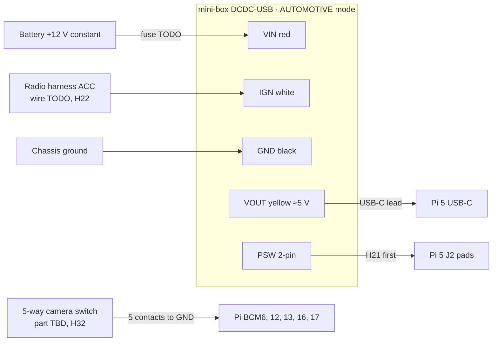

# Power (DCDC-USB) and the camera switch

**Status: DESIGN, NOT VERIFIED. Nothing here has been connected yet.** A person
must check every line against the truck, the DCDC-USB and the camera switch, and
sign it off in [bench-log.md](../hardware/bench-log.md), before it is installed
([safety gates](../safety/assumptions.md#human-verification-gates)).

This is the permanent power and input design from
[ADR-0013](../architecture/adr/0013-dcdc-usb-power-supply.md) and
[ADR-0024](../architecture/adr/0024-camera-selection-switch-and-can-reverse.md).
**No vehicle signal goes to the Pi's GPIO:** reverse comes from HS-CAN through
the gateway, and the turn signals aren't used. Behaviour:
[power-states.md](../architecture/power-states.md). Documented facts about the
parts: [compatibility matrix](../hardware/compatibility-matrix.md#mini-box-dcdc-usb).

> **The DCDC-USB's default output is 12 V.** Set VOUT to about 5 V, and
> **measure it with a meter, before the Pi is connected**. 12 V into the Pi
> destroys it.

## Overview

## Connections

| From | To | Notes |
|---|---|---|
| Battery +12 V, constant | Inline fuse → DCDC-USB **VIN** (red) | Fuse rating and wire gauge: **TODO**, from the measured load ([H25](../hardware/open-questions.md)). The DCDC-USB also has its own 10 A blade fuse. If this comes from the radio harness's constant feed, first check that feed's fuse rating against the load |
| Chassis ground, near the radio | DCDC-USB **GND** (black) | A clean ground point, short run |
| Radio harness **ACC** | DCDC-USB **IGN** (white) | Which wire: **TODO** from the wiring diagram, then confirmed with a meter ([H22](../hardware/open-questions.md)). Fuse: **TODO** |
| DCDC-USB **VOUT** (yellow) and GND (black) | USB-C lead → Pi 5 USB-C | Not into the GPIO header. Short and heavy enough for 5 A. VOUT is set by the 5 V jumper; measure it **at the Pi** under load |
| DCDC-USB **PSW** | Pi 5 **J2** pads | **Only after H21.** J2 wants a normally-open momentary closure. If PSW is a driven voltage, put a reed relay or optocoupler between them. Which pad is ground: TODO, by continuity to a GPIO ground pin |
| DCDC-USB mini-USB | Nothing | Not connected: the system is pulse-only ([ADR-0013](../architecture/adr/0013-dcdc-usb-power-supply.md), 2026-11-09) |
| Camera switch | Pi GPIO, see [below](#camera-switch) | 3.3 V logic only |

## Camera switch

A 5-way switch in the cab picks the camera
([ADR-0024](../architecture/adr/0024-camera-selection-switch-and-can-reverse.md)).
It must be a **digital** switch, one contact per direction and one for the
press, each closing to ground: a navigation switch, a microswitch joystick or
five buttons. An analog joystick module (two potentiometers) needs an ADC,
which the Pi 5 doesn't have. Part, mounting place and cable length: **TODO**
([H32](../hardware/open-questions.md)).

| Contact | Pi GPIO (proposed) | Header pin | Default action |
|---|---|---|---|
| Left | BCM12 | 32 | Left camera |
| Right | BCM13 | 33 | Right camera |
| Back | BCM16 | 36 | Rear camera |
| Forward | BCM6 | 31 | No camera |
| Press | BCM17 | 11 | No camera |
| Common | GND | 34 or 39 | — |

- The pins are proposed, and set in `agl/boot/config-f250.txt`: one
  `gpio-key` overlay per contact, with the internal pull-up, keys F13–F17
  ([ADR-0025](../architecture/adr/0025-camera-switch-through-gpio-key.md)).
  They avoid the
  DAC8x's **BCM18–27** and **BCM5**
  ([ADR-0014](../architecture/adr/0014-multichannel-dac8x.md); leave BCM5
  unconnected), the I2C pins and the UART. Header access with the DAC8x
  fitted: [H27](../hardware/open-questions.md).
- Each line idles high and reads low when its contact closes. Pull-ups: a
  10 kΩ resistor from each line to the Pi's **3.3 V** (pin 1 or 17), near the
  Pi, plus the internal pull-up. Example values; a person checks them.
- A 1 kΩ series resistor in each line at the Pi end limits the current from a
  static discharge on the cable run. Example value.
- **Never 5 V or 12 V on these wires.** The switch carries only the Pi's own
  3.3 V. It isn't connected to anything in the truck.

**Bench candidate:** a 5-way navigation button module
([matrix](../hardware/compatibility-matrix.md#5-way-navigation-button-module-camera-switch-candidate)).
Its pins map as UP → Forward, DWN → Back, LFT → Left, RHT → Right, MID →
Press, COM → GND. Any SET and RST buttons stay unconnected. If the board has a
VCC pin (its own pull-ups), VCC goes to the Pi's **3.3 V**, never 5 V. Check
the labels on the board before wiring; listings differ. The amplifier remote
is not on the Pi; ACC goes straight to it
([wiring/audio.md](audio.md#remote-turn-on-acc-straight-to-rem)). Header access with
the DAC8x fitted: [H27](../hardware/open-questions.md).

## DCDC-USB settings

Set these with the jumpers on the bench before installation. No USB is
needed. A jumper change takes effect at the next power cycle.

| Setting | Value | Source |
|---|---|---|
| Main mode jumper | AUTOMOTIVE | QIG p. 4 |
| Output voltage | The 5 V jumper. If the Pi shows undervoltage at full load (H25), the fallbacks are a one-time trim over USB from a laptop, or the 12 V → 5 V converter ([matrix](../hardware/compatibility-matrix.md)) | QIG p. 3 |
| OFFDELAY / HARDOFF | A jumper preset. Example: 1 min / 1 min. OFFDELAY must cover any ACC dropout while cranking (H22) and be longer than power-manager's boot window. HARDOFF must exceed the worst measured shutdown time | QIG p. 4, [power-states.md](../architecture/power-states.md#how-the-dcdc-usb-sequences-power) |

On the Pi: `PSU_MAX_CURRENT=5000` in the EEPROM (`sudo rpi-eeprom-config -e`),
so it doesn't treat the supply as a 3 A one. Whether this lifts the 600 mA USB
limit is to be checked (H25).

## Checks before sign-off

| # | Check | Expected | Result |
|---|---|---|---|
| 1 | VOUT with a meter, **Pi not connected** | About 5 V, not 12 V | |
| 2 | PSW: voltage across it with the unit powered; continuity when fired from the USB tool | A closure, no driven voltage (H21) | |
| 3 | J2: continuity from each pad to a GPIO ground pin | One pad is ground | |
| 4 | Bench: IGN on → Pi boots; IGN off → pulse after OFFDELAY → clean shutdown → VOUT off after HARDOFF | As described | |
| 5 | Bench: IGN back on during HARDOFF | Record what happens (H23) | |
| 6 | Pi at full load: `vcgencmd get_throttled` | `0x0` | |
| 7 | ACC wire on the truck: key on, crank, run, key off, door open | Record the voltage at each step (H22) | |
| 8 | Each switch line with a meter, Pi powered, switch at rest | 3.3 V on each GPIO, nothing above 3.3 V | |
| 9 | Each switch direction in turn | Only its own line reads 0 V, and `journalctl -u f250-power-manager` logs one `camera switch: left` line (`right`, `back`, `forward`, `press`) per press, followed by the view camera-manager answered with, or why it didn't take the move (camera-manager not running is fine for this check). At start-up it logs `camera switch contacts readable: left, right, back, forward, press` | |
| 10 | Parked draw after HARDOFF | Well under 1 mA (documented claim) | |

Signed off by: _____ Date: _____
