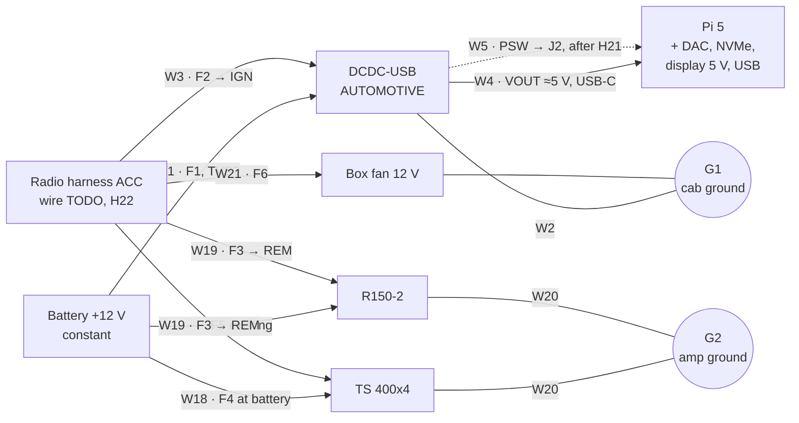
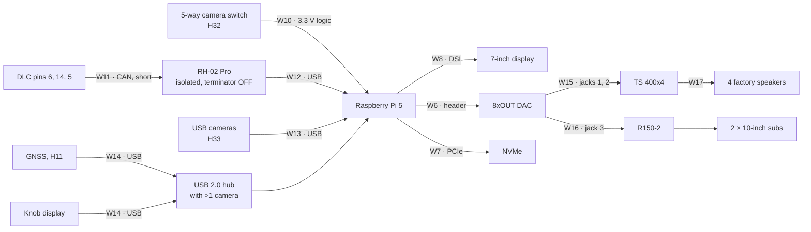

# System overview: every connection in one place

**Status: DESIGN, NOT VERIFIED. Nothing here is installed** (Phase 7.1). This
sheet draws the whole head unit (power, then signals) and lists every wire, so nothing is missed.
The details, fuse ratings and sign-off checks are on the sheets it links to.
A person signs off **each detail sheet** in
[bench-log.md](../hardware/bench-log.md) before its wiring goes in
([safety gates](../safety/assumptions.md#human-verification-gates)).

**No vehicle signal goes to the Pi's GPIO** (CLAUDE.md rule 6). The only
vehicle connections are power (through the DCDC-USB), the amplifiers'
power and remote, and HS-CAN through an isolated USB adapter.

## Power and grounds

## Signals and data

Dashed: waits on an open question before it can be wired. "TVS?" is a
decision still to make ([ground-and-protection.md](ground-and-protection.md#external-tvs-a-decision-to-make)).
The Pi, DAC, NVMe board, DCDC-USB, fan and hub sit in the rear box behind
the display ([ADR-0047](../architecture/adr/0047-head-unit-enclosure.md));
the amplifier is on its own bracket (H37).

## Every connection

| # | From | To | What it carries | Sheet | Blocked by |
|---|---|---|---|---|---|
| W1 | Battery +12 V, constant | DCDC-USB VIN (red), through F1 | Supply | [power-and-inputs](power-and-inputs.md#connections) | Fuse and gauge from the measured load (H25); TVS decision |
| W2 | Chassis ground G1 | DCDC-USB GND (black) | Supply return; the Pi's only ground to the truck | [ground-and-protection](ground-and-protection.md#ground-points) | — |
| W3 | Radio harness ACC | DCDC-USB IGN (white), through F2 | Key position | [power-and-inputs](power-and-inputs.md#connections) | Which wire (H22) |
| W4 | DCDC-USB VOUT (yellow) and GND | Pi 5 USB-C | 5 V | [power-and-inputs](power-and-inputs.md#connections) | VOUT measured ≈5 V with the Pi disconnected (check 1) |
| W5 | DCDC-USB PSW | Pi 5 J2 pads | Power-key pulse | [power-and-inputs](power-and-inputs.md#connections) | H21 (what PSW is electrically) |
| W6 | Pi GPIO header | 8xOUT DAC | I2S | — (a HAT, no wires) | — |
| W7 | Pi PCIe connector | NVMe board | PCIe | — (the board's own FFC) | H4 (stacks with the DAC?), H31 |
| W8 | Pi DSI connector | Display | Video, touch | — | The display-type 22-to-15-way FFC ([shopping list](../hardware/shopping-list.md)) |
| W9 | Pi 5 V and GND header pins | Display 5 V/GND | Display power | [usb-and-cameras](usb-and-cameras.md#display-power) | H27: header access with the DAC fitted |
| W10 | Camera switch, 5 contacts + common | Pi BCM6, 12, 13, 16, 17 and GND | 3.3 V logic | [power-and-inputs](power-and-inputs.md#camera-switch) | H32 (the part), H27 (header access), the 8xOUT's pin 11 (below) |
| W11 | DLC pins 6, 14, 5 | RH-02 Pro CAN H, CAN L, GND | HS-CAN | [can-permanent](can-permanent.md) | The adapter's mounting place and USB run length |
| W12 | RH-02 Pro | Pi USB | USB | [usb-and-cameras](usb-and-cameras.md#port-plan) | — |
| W13 | Cameras | Pi USB (and hub) | Video and the cameras' 5 V | [usb-and-cameras](usb-and-cameras.md#camera-power) | H10, H33, H25 |
| W14 | GNSS receiver, knob display, microphone | Pi USB or the hub | USB | [usb-and-cameras](usb-and-cameras.md#port-plan) | H11, ADR-0044 board, S4 |
| W15 | DAC jacks 1, 2 | TS 400x4 front and rear RCA inputs | Line level | [audio](audio.md#connections) | — |
| W16 | DAC jack 3 | R150-2 RCA inputs | Line level, mono sub | [audio](audio.md#connections) | H28 |
| W17 | TS 400x4 outputs | Radio harness adapter LF±, RF±, LR±, RR± | Speaker level | [audio](audio.md#connections) | Wire colours TODO |
| W18 | Battery +12 V | TS 400x4 B+, through F4 at the battery | Amp supply | [audio](audio.md#connections), [ground-and-protection](ground-and-protection.md#fuses) | H37 (where the amp goes) sets the length |
| W19 | Radio harness ACC | TS 400x4 REM and R150-2 REM, through F3 | Remote turn-on | [audio](audio.md#remote-turn-on-acc-straight-to-rem) | H22 |
| W20 | Chassis ground G2 | TS 400x4 GND and R150-2 GND | Amp returns | [ground-and-protection](ground-and-protection.md#ground-points) | Where the R150-2 is grounded today (H28) |
| W21 | Radio harness ACC | Box fan +, through F6; fan − to G1 | Fan | [ground-and-protection](ground-and-protection.md#fuses) | The fan's part and current |
| W22 | DCDC-USB mini-USB | Nothing | — | [power-and-inputs](power-and-inputs.md#connections) | Not connected (pulse-only) |

Antennas: Bluetooth and Wi-Fi are on the Pi's board. The GNSS receiver's
antenna position waits on the receiver (H11). Keep it away from USB 3
cables, which radiate in the 2.4 GHz band ([ADR-0047](../architecture/adr/0047-head-unit-enclosure.md) decision 6).

## Conflicts to settle before wiring

- **Header pin 11 (BCM17).** The camera switch's Press contact is proposed
  on BCM17. RaspiAudio's pinout lists a data line on GPIO17 for the 8xOUT,
  although all four jacks play with the overlay's pins
  ([ADR-0014](../architecture/adr/0014-multichannel-dac8x.md), H27). Check
  with a meter that pin 11 isn't connected on the 8xOUT. If it is, move
  Press to another free pin and change `agl/boot/config-f250.txt` with it.
- **The display's 5 V and the DAC on the header.** The display takes 5 V
  and GND from the header through jumper wires. With the DAC fitted, those
  pins must still be reachable: a pass-through header, a stacking header or
  a breakout (H27).
- **USB ports.** With one camera, the four ports are already full (CAN,
  GNSS, knob, camera). A USB microphone would need the hub too
  ([usb-and-cameras](usb-and-cameras.md#port-plan)).
